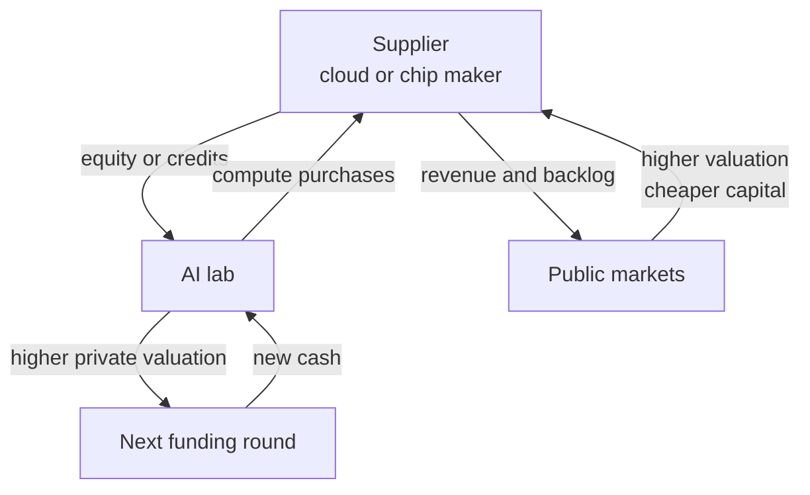

import FundingGraph from "../../components/FundingGraph";

{/* TODO intro, 2 to 3 paragraphs: the AI funding trap in one sentence, why it matters (the same dollar shows up as investment, revenue and backlog), and that Anthropic is the case study. */}

## How Circular Financing Works in AI

{/* TODO prose: a supplier invests in its customer, the customer spends the money back with the supplier, the supplier books revenue and a higher valuation, which supports the next round. */}

## Anthropic Funding: A Case Study

{/* TODO prose intro: Anthropic raised from venture funds in the usual way, then from the companies it buys compute from. The second channel is where the loop forms. */}

### Equity Rounds

{/* TODO prose. Series B was led by Sam Bankman-Fried; the FTX estate later sold the stake to other investors, Anthropic received nothing from those sales. */}

| Date | Round | Amount | Post money | Lead |
|---|---|---:|---:|---|
| May&#8209;21 | [Series&nbsp;A](https://www.anthropic.com/news/anthropic-raises-124-million-to-build-more-reliable-general-ai-systems) | \$124M | N/D | Jaan Tallinn |
| Apr&#8209;22 | [Series&nbsp;B](https://www.anthropic.com/news/anthropic-raises-series-b-to-build-safe-reliable-ai) | \$580M | N/D | Sam Bankman-Fried |
| May&#8209;23 | [Series&nbsp;C](https://www.anthropic.com/news/anthropic-series-c) | \$450M | N/D | Spark Capital |
| Mar&#8209;25 | [Series&nbsp;E](https://www.anthropic.com/news/anthropic-raises-series-e-at-usd61-5b-post-money-valuation) | \$3,500M | \$61.5B | Lightspeed |
| Sep&#8209;25 | [Series&nbsp;F](https://www.anthropic.com/news/anthropic-raises-series-f-at-usd183b-post-money-valuation) | \$13,000M | \$183.0B | ICONIQ |
| Feb&#8209;26 | [Series&nbsp;G](https://www.anthropic.com/news/anthropic-raises-30-billion-series-g-funding-380-billion-post-money-valuation) | \$30,000M | \$380.0B | GIC and Coatue |
| May&#8209;26 | [Series&nbsp;H](https://www.anthropic.com/news/series-h) | \$65,000M | \$965.0B | Altimeter, Dragoneer, Greenoaks and Sequoia |

*N/D: not disclosed.*

- **Series&nbsp;C, May&#8209;23:** Google took part.
- **Series&nbsp;G, Feb&#8209;26:** Part of the Microsoft and Nvidia commitments, and [\$5B from Amazon](https://www.sec.gov/Archives/edgar/data/0001018724/000101872426000026/amzn-20260630.htm).
- **Series&nbsp;H, May&#8209;26:** \$15B of earlier hyperscaler commitments, another \$5B from Amazon.

{/* TODO prose. Series G includes a portion of the Microsoft and Nvidia commitments, Series H includes \$15B of previously committed hyperscaler money, another \$5B from Amazon. Supplier money is inside the "venture" rounds. */}

### Notes, Facilities and Strategic Commitments

{/* TODO prose: the second channel. Suppliers fund Anthropic between the priced rounds, mostly with convertible notes tied to a compute contract. Each new round reprices the notes upward, the notes convert into the round's preferred stock, and the supplier books the gain. Amounts marked up to are commitments, not cash paid. */}

| Date | Supplier | Amount | Instrument |
|---|---|---:|---|
| Sep&#8209;23 | Amazon | \$1,250M | Convertible&nbsp;note |
| Oct&#8209;23 | Google | \$2,000M | Convertible&nbsp;note |
| Mar&#8209;24 | Amazon | \$2,750M | Convertible&nbsp;note |
| Dec&#8209;24 | Amazon | \$1,300M | Convertible&nbsp;note |
| Jan&#8209;25 | Google | \$1,000M | N/D |
| May&#8209;25 | Banks | \$2,500M | Revolving&nbsp;credit&nbsp;facility |
| Jun&#8209;25 | Amazon | \$1,300M | Convertible&nbsp;note |
| Sep&#8209;25 | Google | \$750M | Convertible&nbsp;debt |
| Nov&#8209;25 | Microsoft | \$5,000M | Strategic&nbsp;investment |
| Nov&#8209;25 | Nvidia | \$10,000M | Strategic&nbsp;investment |
| Dec&#8209;25 | Amazon | \$1,400M | Convertible&nbsp;note |
| Apr&#8209;26 | Amazon | \$20,000M | Financing&nbsp;facility |
| Apr&#8209;26 | Google | \$40,000M | Cash&nbsp;and&nbsp;compute |
| Jul&#8209;26 | AMD | \$5,000M | Strategic&nbsp;equity |

*N/D: not disclosed.*

- **Amazon, Sep&#8209;23:** First tranche of a commitment of up to \$4B, with AWS as primary cloud provider. Paid in Q3 2023 ([Amazon 10-Q](https://www.sec.gov/Archives/edgar/data/1018724/000101872424000130/amzn-20240630.htm)).
- **Google, Oct&#8209;23:** Up to \$2B, \$500M upfront and \$1.5B over time, converting into equity at the next priced round ([CNBC](https://www.cnbc.com/2023/10/27/google-commits-to-invest-2-billion-in-openai-competitor-anthropic.html)).
- **Amazon, Mar&#8209;24:** Completes the first \$4B. Paid in Q1 2024 ([Amazon 10-Q](https://www.sec.gov/Archives/edgar/data/1018724/000101872424000130/amzn-20240630.htm)).
- **Amazon, Dec&#8209;24:** First part of a further \$4B, with AWS as primary training partner. Paid in Q4 2024 ([Amazon 10-Q](https://www.sec.gov/Archives/edgar/data/1018724/000101872425000123/amzn-20250930.htm)).
- **Google, Jan&#8209;25:** More than \$1B, first reported by the FT ([TechCrunch](https://techcrunch.com/2025/01/22/anthropic-reportedly-secures-an-additional-1b-from-google)).
- **Banks, May&#8209;25:** Five years, from Morgan Stanley, Barclays, Citi, Goldman Sachs, JPMorgan, RBC and MUFG ([CNBC](https://www.nbclosangeles.com/news/business/money-report/anthropic-closes-2-5-billion-credit-facility-as-wall-street-continues-plunging-money-into-ai-boom/3702862/)).
- **Amazon, Jun&#8209;25:** Paid in Q2 2025 ([Amazon 10-Q](https://www.sec.gov/Archives/edgar/data/1018724/000101872425000123/amzn-20250930.htm)).
- **Google, Sep&#8209;25:** Due in September 2025 according to court filings in the Google antitrust case, which also show a 14% stake capped at 15% with no voting rights ([Computing](https://www.computing.co.uk/news/2025/ai/google-revealed-to-hold-14-stake-in-anthropic)).
- **Microsoft, Nov&#8209;25:** Up to \$5B, paired with Anthropic's \$30B Azure commitment. Part of it is included in Series G ([Anthropic](https://www.anthropic.com/news/microsoft-nvidia-anthropic-announce-strategic-partnerships)).
- **Nvidia, Nov&#8209;25:** Up to \$10B, paired with up to 1 GW of Nvidia systems. Part of it is included in Series G ([Anthropic](https://www.anthropic.com/news/microsoft-nvidia-anthropic-announce-strategic-partnerships)).
- **Amazon, Dec&#8209;25:** Paid in Q4 2025, bringing Amazon's notes to \$8B. Part of the notes converted into nonvoting preferred stock ([Amazon 10-Q](https://www.sec.gov/Archives/edgar/data/0001018724/000101872426000014/amzn-20260331.htm)).
- **Amazon, Apr&#8209;26:** Up to \$20B, nothing drawable at the start. It opens as AWS delivers the compute Anthropic committed to buy, is drawn as convertible notes or common stock after an IPO, and expires 30 months after an IPO. Cut to \$15B when Amazon put \$5B into Series H ([Amazon 10-Q](https://www.sec.gov/Archives/edgar/data/0001018724/000101872426000026/amzn-20260630.htm)).
- **Google, Apr&#8209;26:** Up to \$40B, \$10B now and up to \$30B tied to performance targets. Instrument not disclosed ([TechCrunch](https://techcrunch.com/2026/04/24/google-to-invest-up-to-40b-in-anthropic-in-cash-and-compute/)).
- **AMD, Jul&#8209;26:** Up to \$5B committed for the future, paired with up to 2 GW of AMD MI450 GPUs ([AMD](https://ir.amd.com/news-events/press-releases/detail/1292/amd-and-anthropic-announce-strategic-partnership-to-deploy-up-to-2-gigawatts-of-amd-instinct-mi450-series-gpus)).

### Amazon

{/* TODO prose. */}

- September 2023: Amazon commits up to \$4B and AWS becomes Anthropic's primary cloud provider ([Anthropic](https://www.anthropic.com/news/anthropic-amazon)).
- November 2024: a further \$4B, bringing the total to \$8B, and AWS becomes the primary training partner on Trainium ([Anthropic](https://www.anthropic.com/news/anthropic-amazon-trainium)).
- Amazon's filings show the \$8B was paid in convertible notes between Q3 2023 and Q4 2025, part of which later converted into nonvoting preferred stock ([Amazon 10-Q, Q3 2025](https://www.sec.gov/Archives/edgar/data/1018724/000101872425000123/amzn-20250930.htm)).
- April 2026: Anthropic commits more than \$100B over ten years to AWS, Amazon invests \$5B now and up to \$20B later ([Anthropic](https://www.anthropic.com/news/anthropic-amazon-compute)).
- The \$20B is a financing facility that opens only as AWS delivers the compute Anthropic pays for, drawn as new convertible notes ([Amazon 10-Q, Q2 2026](https://www.sec.gov/Archives/edgar/data/0001018724/000101872426000026/amzn-20260630.htm)).
- Amazon booked \$62.8B of upward adjustments in the first half of 2026, primarily from its Anthropic preferred stock (same 10-Q).

### Google

{/* TODO prose. */}

- October 2023: up to \$2B as a convertible note, \$500M upfront ([CNBC](https://www.cnbc.com/2023/10/27/google-commits-to-invest-2-billion-in-openai-competitor-anthropic.html)).
- Court filings in the Google antitrust case showed a 14% stake capped at 15%, with no voting rights and no board seat ([Computing](https://www.computing.co.uk/news/2025/ai/google-revealed-to-hold-14-stake-in-anthropic)).
- October 2025: Anthropic expands to up to one million TPUs, worth tens of billions of dollars ([Anthropic](https://www.anthropic.com/news/expanding-our-use-of-google-cloud-tpus-and-services)).
- April 2026: multiple gigawatts of next generation TPU capacity with Google and Broadcom from 2027 ([Anthropic](https://www.anthropic.com/news/google-broadcom-partnership-compute)).
- April 2026: Google invests up to \$40B in cash and compute, \$10B now and up to \$30B tied to performance targets ([TechCrunch](https://techcrunch.com/2026/04/24/google-to-invest-up-to-40b-in-anthropic-in-cash-and-compute/)).
- Alphabet reported a \$98.0B net gain in other income for Q2 2026, primarily unrealized gains on equity securities ([Alphabet Q2 2026](https://www.sec.gov/Archives/edgar/data/0001652044/000165204426000066/googexhibit991q22026.htm)). {/* Alphabet does not name Anthropic: attribute to press, Fortune. */}

### Microsoft and Nvidia

- November 2025: Microsoft invests up to \$5B and Nvidia up to \$10B, Anthropic commits to \$30B of Azure compute and up to 1 GW of Nvidia systems ([Anthropic](https://www.anthropic.com/news/microsoft-nvidia-anthropic-announce-strategic-partnerships)).

### AMD, Akamai and Its Own Data Centres

- November 2025: \$50B of Anthropic's own data centres in Texas and New York with Fluidstack ([Anthropic](https://www.anthropic.com/news/anthropic-invests-50-billion-in-american-ai-infrastructure)).
- July 2026: up to 2 GW of AMD MI450 GPUs, and AMD commits a strategic equity investment of up to \$5B in Anthropic ([AMD](https://ir.amd.com/news-events/press-releases/detail/1292/amd-and-anthropic-announce-strategic-partnership-to-deploy-up-to-2-gigawatts-of-amd-instinct-mi450-series-gpus)).
- September 2026: \$11.6B of commitments to Akamai over seven years, and Akamai issues Anthropic a warrant for about 5% of its stock, vesting as the commitments grow ([Akamai 8-K](https://www.sec.gov/Archives/edgar/data/0001086222/000119312526401048/d288154d8k.htm)).

### Revenue Against Commitments

{/* TODO prose. Revenue growth is real, but the commitments are an order of magnitude larger and mostly non cancellable. */}

| When | Run rate revenue | Source |
|---|---:|---|
| Aug&#8209;25 | over \$5B | [Anthropic](https://www.anthropic.com/news/anthropic-raises-series-f-at-usd183b-post-money-valuation) |
| Feb&#8209;26 | \$14B | [Anthropic](https://www.anthropic.com/news/anthropic-raises-30-billion-series-g-funding-380-billion-post-money-valuation) |
| Jul&#8209;26 | over \$65B | [Investing.com](https://www.investing.com/news/stock-market-news/anthropic-revenue-run-rate-tops-65-billion-source-says-4864031) |

- Reuters, reporting on the confidential IPO prospectus: at least \$518B of infrastructure commitments over a decade, about 80% of it non cancellable or payable regardless of usage ([BusinessDay](https://www.businessday.co.za/world/international-companies/2026-09-29-anthropic-plans-518bn-ai-infrastructure-spend-80-non-cancellable/)).
- The same prospectus reportedly shows 2025 revenue of about \$4.6B and an operating loss of \$8.06B ([Fortune](https://fortune.com/2026/09/29/anthropic-leaked-ipo-prospectus-losses-growth-ai-end-humanity/)).

## The Financing Vehicles Behind the Loop

### Strategic Equity Paid Back as Cloud Spend

{/* TODO prose. Definition, money flow, examples. */}

- Amazon invested \$4B in Anthropic in 2023 and another \$4B in November 2024, and AWS became Anthropic's primary training partner ([TechCrunch](https://techcrunch.com/2024/11/22/anthropic-raises-an-additional-4b-from-amazon-makes-aws-its-primary-cloud-partner/)).
- In its recapitalisation of October 2025, OpenAI contracted an incremental \$250B of Azure services, while Microsoft holds about 27% of OpenAI ([Microsoft 10-Q](https://www.sec.gov/Archives/edgar/data/789019/000119312525256321/msft-20250930.htm)).
- In February 2026 Amazon committed up to \$50B to OpenAI, and OpenAI expanded its AWS contract by \$100B over eight years ([CNBC](https://www.cnbc.com/2026/02/27/open-ai-funding-round-amazon.html), [GeekWire](https://www.geekwire.com/2026/amazon-invests-50b-in-openai-deepens-aws-partnership-with-expanded-100b-cloud-deal/)).

### Convertible Notes

{/* TODO prose. Definition link to verify. Google into Anthropic, October 2023: \$500M upfront, \$1.5B later, converting at the next round. */}

- Google committed \$2B to Anthropic in October 2023 as debt converting into equity at the next round ([BNN Bloomberg](https://www.bnnbloomberg.ca/google-to-invest-2-billion-in-ai-startup-anthropic-wsj-says-1.1990522)).

### Vendor Financing

{/* TODO prose. Nvidia and OpenAI: from the \$100B letter of intent to a \$30B stake. Nvidia and CoreWeave. */}

- September 2025: Nvidia intends to invest up to \$100B in OpenAI progressively as each gigawatt is deployed ([Nvidia](https://investor.nvidia.com/news/press-release-details/2025/OpenAI-and-NVIDIA-Announce-Strategic-Partnership-to-Deploy-10-Gigawatts-of-NVIDIA-Systems/)).
- March 2026: OpenAI closes a \$122B round at an \$852B valuation, with Nvidia taking \$30B in place of the original plan ([Bloomberg Tax](https://news.bloombergtax.com/financial-accounting/openai-valued-at-852-billion-after-closing-122-billion-round)).
- January 2026: Nvidia invests another \$2B in CoreWeave, one of its largest GPU customers ([Bloomberg](https://www.bloomberg.com/news/articles/2026-01-26/nvidia-invests-another-2-billion-in-coreweave-offers-new-chip)).

### Equity Warrants as a Sales Incentive

{/* TODO prose. Warrant vests as the customer buys GPUs. */}

- October 2025: AMD grants OpenAI a warrant for up to 160M AMD shares, vesting as 6 GW of AMD GPUs are deployed ([AMD](https://ir.amd.com/news-events/press-releases/detail/1260/)).
- February 2026: AMD signs the same warrant structure with Meta ([NY1](https://ny1.com/nyc/all-boroughs/ap-top-news/2026/02/24/facebook-owner-meta-to-buy-ai-chips-from-amd-in-deal-worth-up-to-100-billion)).

### Compute Commitments and Backlog

{/* TODO prose. Remaining performance obligations: contracted revenue not yet recognised. Take or pay contracts become backlog, backlog supports borrowing. */}

- Oracle's remaining performance obligations reached \$664B in fiscal Q1 2027, about 13% of it expected to be recognised within twelve months ([Oracle 10-Q](https://www.sec.gov/Archives/edgar/data/0001341439/000119312526389274/orcl-20260831.htm)).
- Nvidia agreed to buy CoreWeave's unsold capacity through 2032, with an initial order of \$6.3B ([RCR Wireless](https://www.rcrwireless.com/20250916/ai-infrastructure/nvidia-cloud)).
- Nvidia guarantees up to \$105B of lease obligations for an OpenAI campus in Ohio ([Nvidia 10-Q](https://www.sec.gov/Archives/edgar/data/0001045810/000104581026000075/nvda-20260726.htm)).

### Special Purpose Vehicles

{/* TODO prose. Definition link to verify. Debt sits in a separate entity, the tech company leases the asset. */}

- Meta's Hyperion campus: a joint venture 80% owned by Blue Owl funds, about \$27B of development cost, a four year initial lease and a 16 year residual value guarantee from Meta ([Meta](https://about.fb.com/news/2025/10/meta-blue-owl-capital-develop-hyperion-data-center/)).
- Stargate LLC: OpenAI, SoftBank, Oracle and MGX, up to \$500B over four years ([OpenAI](https://openai.com/index/announcing-the-stargate-project/)).

### GPU Backed Debt

{/* TODO prose. Delayed draw term loans secured by GPUs, repaid from rental contracts. Depreciation debate. */}

- Lambda's \$500M facility secured by the GPUs it finances ([Business Wire](https://www.businesswire.com/news/home/20240402148086/en/Lambda-Announces-\$500M-GPU-Backed-Facility-to-Expand-Cloud-for-AI)).
- CoreWeave's \$8.5B delayed draw term loan of March 2026 ([DCD](https://www.datacenterdynamics.com/en/news/coreweave-secures-85bn-loan-for-gpu-purchases/)).
- Michael Burry's argument that hyperscalers overstate GPU useful lives ([Yahoo Finance](https://finance.yahoo.com/news/understanding-michael-burrys-bet-against-120000277.html)).

### Corporate Bonds and Credit Default Swaps

{/* TODO prose. Meta \$30B, Alphabet \$17.5B plus EUR 6.5B, Oracle \$45B to \$50B plan. CDS as the market's price of default risk. */}

## The Anthropic Dependency Graph

{/* TODO prose: how to read the graph. Solid arrows are money or equity into Anthropic, thick arrows are Anthropic's compute commitments back, dotted arrows are conditional money or gains booked on the stake. Click a company to open its deals. */}

<FundingGraph client:load />

## Where the Loop Becomes a Trap

{/* TODO prose. Lucent vendor financing in 2000 (SEC filings), Bank of England FPC September 2026 on circular arrangements, IMF GFSR April 2026. */}

- Lucent's commitments to finance its own customers stood at about \$8.1B in September 2000 ([Lucent 10-Q](https://www.sec.gov/Archives/edgar/data/0001006240/000095011701500911/a31155.txt)).
- The Bank of England's Financial Policy Committee warns that circular arrangements associated with AI financing could amplify losses ([FPC record](https://www.bankofengland.co.uk/financial-policy-committee-record/2026/september-2026)).
- The IMF says circular finance may amplify systemic risk by inflating valuations and masking underlying demand ([IMF GFSR](https://www.imf.org/-/media/files/publications/gfsr/2026/april/english/ch1.pdf)).

## Conclusion

{/* TODO 1 to 2 paragraphs. */}
